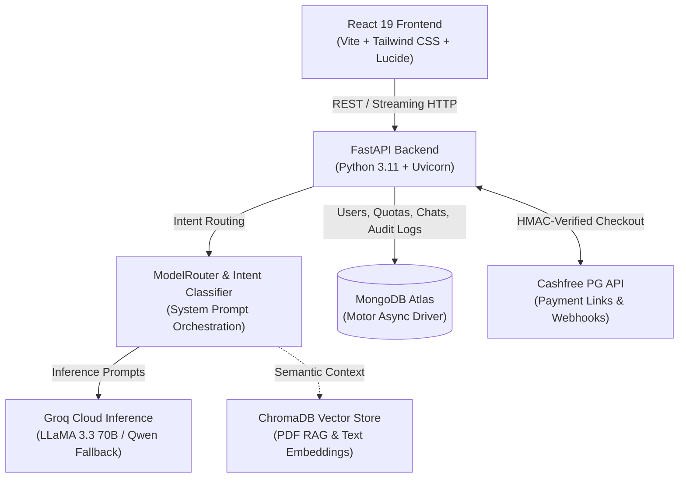

# 🦁 Simha AI — Intelligent Multi-Agent AI Platform

[](https://fastapi.tiangolo.com)
[](https://react.dev)
[](https://python.org)
[](https://www.mongodb.com)
[](https://trychroma.com)
[](https://cashfree.com)
[](https://groq.com)

**Simha AI** is an independent, full-stack multi-agent AI SaaS platform. Rather than routing all queries through a monolithic generalist prompt, Simha AI employs a server-side **ModelRouter** that classifies user intent and dispatches queries to domain-specialized agent personas, augmented by ChromaDB vector retrieval and a server-side entitlement engine with Cashfree payments.

---

> [!IMPORTANT]
> **Independent Software Notice:**  
> Simha AI is an independent software application and academic portfolio project. It is **not** affiliated with, sponsored by, or endorsed by OpenAI, Google, Anthropic, or Meta. Inference is executed via licensed cloud API providers (Groq LPUs with open-weights models such as LLaMA 3.3 70B and Qwen).

---

## 🏗️ System Architecture



---

## 🤖 Specialized Agent Ecosystem

Simha AI partitions user tasks into specialized agent profiles:

| Agent | Core Focus | Technical Implementation |
| :--- | :--- | :--- |
| **Simha Chat** | Conversational dialogue & context recall | History sliding window (15 turns) with user memory persistence. |
| **Simha Code** | Architecture, refactoring & algorithm design | Strict system prompt enforcing time/space complexity analysis (Big-O). |
| **Simha Study** | Pedagogical concept breakdowns & interview prep | First-principles explanations, interactive quizzes, and step-by-step derivations. |
| **Simha Docs** | Semantic document analysis | PDF ingestion, chunking, and similarity vector retrieval via ChromaDB. |
| **Simha Vision** | Visual analysis & diagram reasoning | Multimodal image understanding via Groq/Gemini vision inference models. |
| **Simha Wisdom** | Reflective clarity on focus & duty | Vector-augmented retrieval over embedded classical philosophical literature. |
| **Simha Productivity**| Sprint planning & email draft generation | Prompt-engineered time-blocking frameworks and structured templates *(Note: Produces text output; does not connect to external Google Calendar/Gmail APIs)*. |

---

## 💳 Payment Gateway & Entitlement Architecture

Simha AI features a server-controlled subscription and quota management engine powered by **Cashfree Payment Gateway** (`2023-08-01` API):

```
User Click Upgrade
       │
       ▼
FastAPI (POST /api/payments/create-link) ──> Cashfree Payment Link API (₹99.00 INR)
                                                    │
                                                    ▼
Customer Checkout ◄───────────────────── Hosted Cashfree Checkout Page
       │ (UPI, Cards, NetBanking)
       ▼
Cashfree Webhook (POST /api/payments/cashfree/webhook)
       │
       ├── 1. Verify Timestamp & HMAC-SHA256 signature (x-webhook-signature)
       ├── 2. Independent Server Status Poll (GET /links/{id})
       └── 3. Idempotent Entitlement Activation (7-Day Pass: access_expires_at = now + 7d)
```

### Entitlement Matrix
- **Free Tier (₹0):** 10 messages/day, 2 document uploads/day. Access to Chat, Code, and Study agents.
- **7-Day Pass (₹99):** 100 messages/day, 20 document uploads/day. Full access to Vision, Docs RAG, and high-throughput routing.
- **Expiration Policy:** Passes are strictly non-recurring. Upon expiry (`access_expires_at < current_time`), accounts gracefully revert to the Free tier without data loss.

---

## 🗂️ Project Structure

```
simha-ai/
├── backend/
│   ├── agents/               # Domain agent implementations & ModelRouter
│   ├── ai/                   # Groq / fallback provider interface
│   ├── models/               # Pydantic schemas and MongoDB models
│   ├── rag/                  # PDF processor & vector store logic
│   ├── routes/               # FastAPI endpoints (chat, auth, payments, admin)
│   ├── security/             # JWT auth, password hashing, and IP rate limiting
│   ├── services/             # Cashfree payment, entitlement, and usage logic
│   ├── tests/                # Automated pytest test suites (6 test files)
│   ├── .env.example          # Backend environment configuration template
│   ├── Dockerfile            # Container deployment specification
│   ├── requirements.txt      # Python dependencies
│   └── main.py               # FastAPI application entry point
│
├── frontend/
│   ├── src/
│   │   ├── components/       # ChatArea, Sidebar, Header, Modals
│   │   ├── pages/            # Home, LandingPage, Pricing, AdminDashboard
│   │   └── services/         # Axios client & auth services
│   ├── .env.example          # Frontend environment template
│   └── package.json
│
├── .gitignore                # Environment, database, and artifact ignore rules
├── render.yaml               # Render Blueprint infrastructure spec
└── README.md
```

---

## 🚀 Quickstart & Local Setup

### Prerequisites
- Python 3.11+
- Node.js 18+
- MongoDB instance (Local or [MongoDB Atlas](https://www.mongodb.com/cloud/atlas))
- Groq Cloud API Key ([console.groq.com](https://console.groq.com))

### 1. Clone the Repository
```bash
git clone https://github.com/Narasimhamanam/simha-ai.git
cd simha-ai
```

### 2. Backend Setup
```bash
cd backend
python -m venv .venv

# On Windows:
.venv\Scripts\activate
# On macOS / Linux:
source .venv/bin/activate

pip install -r requirements.txt
cp .env.example .env
# Edit .env and supply your MONGO_URL and GROQ_API_KEY

uvicorn main:app --reload --port 8000
# Backend running at http://localhost:8000 (Docs: http://localhost:8000/docs)
```

### 3. Frontend Setup
```bash
# In a separate terminal
cd frontend
cp .env.example .env
# VITE_BACKEND_URL defaults to http://localhost:8000

npm install
npm run dev
# Frontend running at http://localhost:5173
```

---

## 🧪 Automated Test Suite

The repository includes a comprehensive test suite across security, billing, and isolation:

```bash
cd backend
pytest tests/ -v
```

### Test Coverage Highlights:
- **`tests/test_auth_and_isolation.py`**: Verifies user data isolation and unauthorized route guards.
- **`tests/test_cashfree_payment.py`**: Validates payment link creation, mock webhook payload signatures, and idempotency.
- **`tests/test_entitlement_and_usage.py`**: Validates daily message quota resets and 7-day expiration state transitions.
- **`tests/test_doc_and_vision.py`**: Verifies document upload size caps and vision fallback chains.

---

## ⚠️ Limitations & Honest Status

- **External Integrations:** Email and Calendar productivity features output formatted drafts and time-blocking schedules via prompt engineering; direct external OAuth syncing with Google Workspace is not currently implemented.
- **Inference Dependence:** System availability relies on upstream Groq Cloud LPU availability; fallback chains are configured to degrade gracefully to secondary model endpoints during rate limits.
